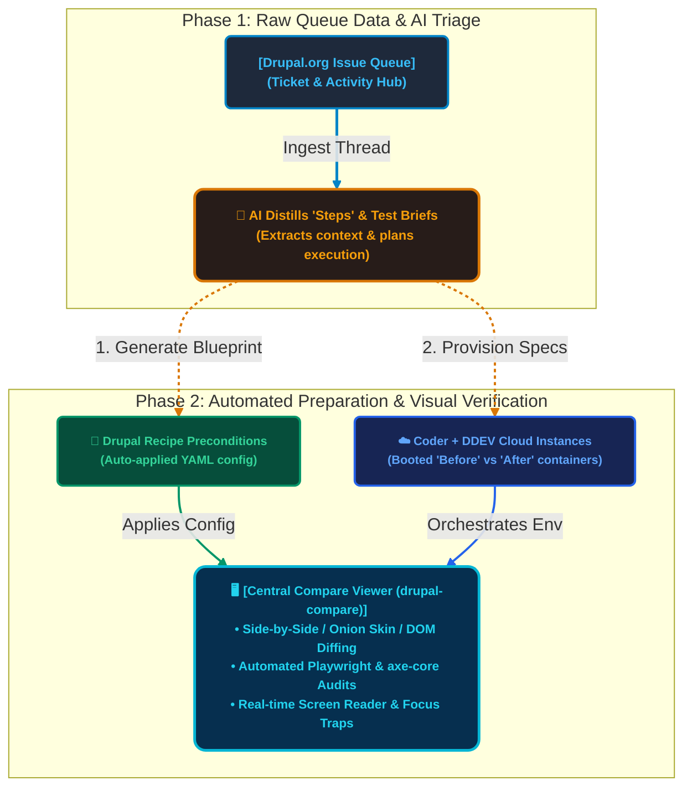

# Drupal Issue Queue Management

## Old

```mermaid
flowchart TD
    %% Define Global Styles
    classDef phaseBox fill:#1e1b15,stroke:#D69E2E,stroke-width:2px,color:#F6AD55,font-size:12px,font-weight:bold,rx:5px,ry:5px;
    classDef phaseBoxCyan fill:#13252a,stroke:#319795,stroke-width:2px,color:#4FD1C5,font-size:12px,font-weight:bold,rx:5px,ry:5px;
    classDef phaseBoxGreen fill:#14241d,stroke:#38A169,stroke-width:2px,color:#68D391,font-size:12px,font-weight:bold,rx:5px,ry:5px;

    %% Row 1 Setup: Define placement & connect L-to-R
    Node1["[Issue Queue Thread]<br/>(80+ comments)"]:::phaseBox
    Node2["[Local Stack Setup]<br/>(DDEV/Apache/PHP)"]:::phaseBoxCyan
    Node3["[Manual Recipe/Setup]<br/>(Content, Fields, Roles)"]:::phaseBoxGreen
    
    Node1 -->|1. Locate Patch| Node2
    Node2 -->|2. Build Base| Node3

    %% Row 2 Setup: Define placement & connect R-to-L
    Node4["[Apply Patch & Re-install]<br/>(Git apply / Drush)"]:::phaseBoxGreen
    Node5["[Manual Comparison]<br/>(Dual Browsers)"]:::phaseBoxCyan
    Node6["[Issue Queue Feedback]<br/>(RTBC / Needs Work)"]:::phaseBox

    Node4 -->|4. Inspect Diff| Node5
    Node5 -->|5. Verify Changes| Node6

    %% Cascading vertical connect between Row 1 and Row 2
    Node3 -->|3. Establish Preconditions| Node4

    %% Visual feedback loop (Bottom left to top left)
    Node6 -.->|6. Restart Loop| Node1

    %% Align Row 1 and Row 2 horizontally side-by-side using group alignments
    subgraph Row1 [Setup Workspace (Top Row)]
        direction LR
        Node1
        Node2
        Node3
    end

    subgraph Row2 [Manual Evaluation (Bottom Row)]
        direction RL
        Node4
        Node5
        Node6
    end

    %% Style connection routes manually
    linkStyle 0 stroke:#D69E2E,stroke-width:2px;
    linkStyle 1 stroke:#319795,stroke-width:2px;
    linkStyle 2 stroke:#38A169,stroke-width:2px;
    linkStyle 3 stroke:#38A169,stroke-width:2px;
    linkStyle 4 stroke:#319795,stroke-width:2px;
    linkStyle 5 stroke:#D69E2E,stroke-width:2px,stroke-dasharray: 4 4;
```

## New


